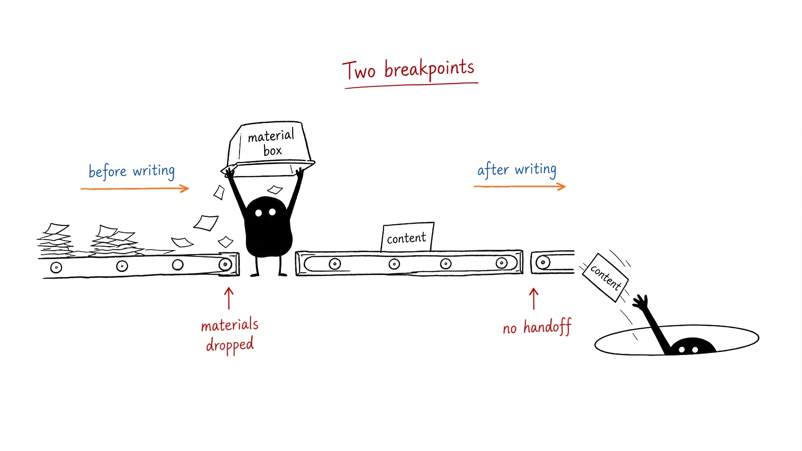
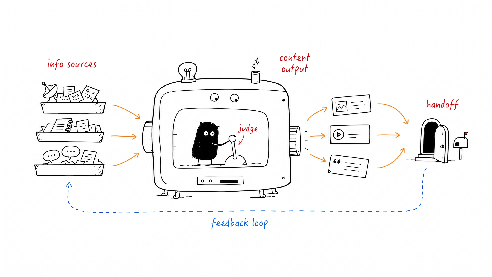
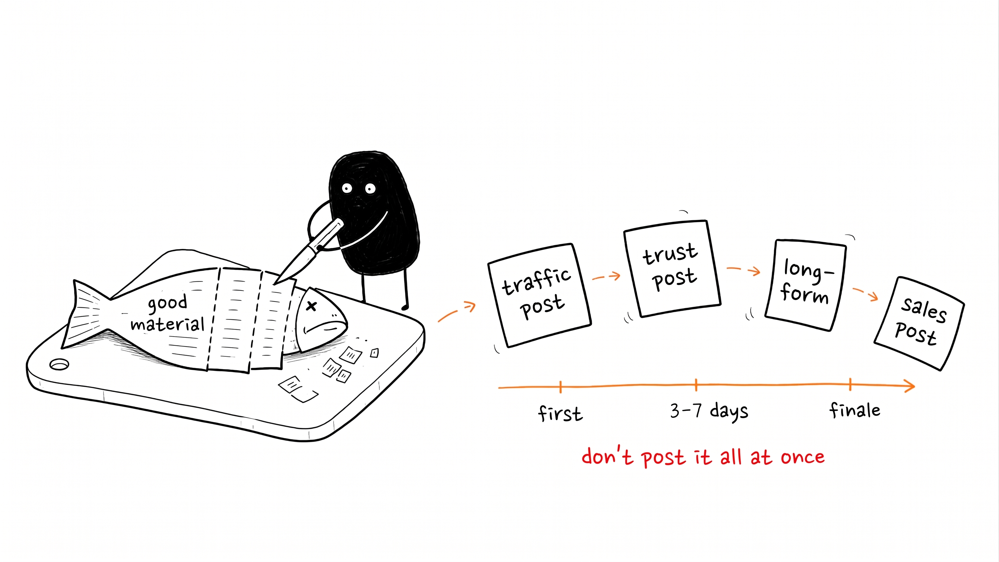
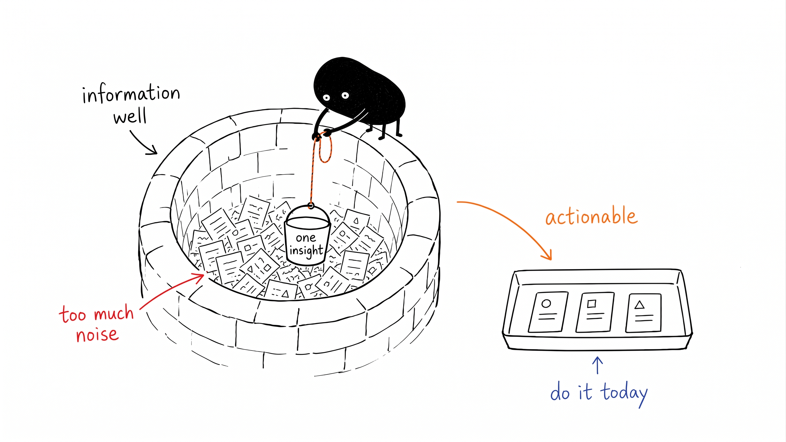
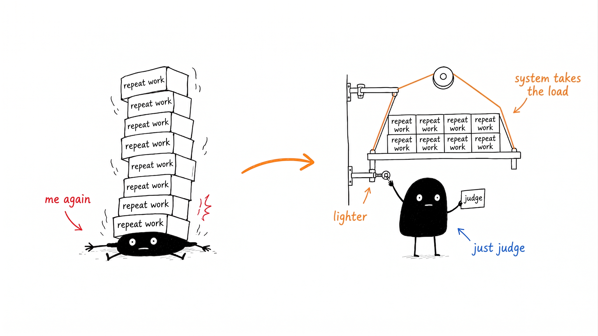

# Ian Illustrations (English Port)

An English port of [Ian Xiaohei Illustrations](https://github.com/helloianneo/ian-xiaohei-illustrations) — an AI-agent skill that generates weird, clean, hand-drawn body illustrations for articles, starring a small solid-black creature (小黑, called **Blot** in this port).

The skill turns an article's key judgments, processes, structures, and metaphors into 16:9 hand-drawn explanatory images: pure white background, wobbly black line art, sparse red/orange/blue handwritten annotations, lots of white space — clear but never an instruction manual.



## What's in the skill

```text
ian-xiaohei-illustrations/
  SKILL.md                            # core positioning + workflow
  references/
    style-dna.md                      # visual law: color, text, taboos
    xiaohei-ip.md                     # Blot: appearance, personality, action library
    composition-patterns.md           # structure types + original-metaphor method
    prompt-template.md                # per-image generation prompt template
    qa-checklist.md                   # pass/fail checks + iteration rules
  assets/examples/                    # 14 style-calibration images (English labels)
  agents/openai.yaml                  # OpenAI agent interface metadata
```

## Install

Copy the skill folder into your agent's skills directory, e.g. for Claude Code:

```bash
cp -R ian-xiaohei-illustrations ~/.claude/skills/
```

The skill assumes an image-generation backend is available (e.g. `image_gen` in ChatGPT/Codex, or a Gemini image-generation script in Claude Code).

## Usage

- "Analyze where this article needs illustrations" → returns a shot list (placement, theme, structure, what Blot does, suggested labels)
- "Generate the illustrations" → generates each 16:9 image separately and QA-checks them
- "Remove the title from this image / make it weirder" → edit prompts included

## More examples

| | |
|---|---|
|  |  |
|  |  |

## Attribution

Original skill, character, and visual language by **Ian** — see [NOTICE.md](NOTICE.md). Licensed MIT (see [LICENSE](LICENSE)).
